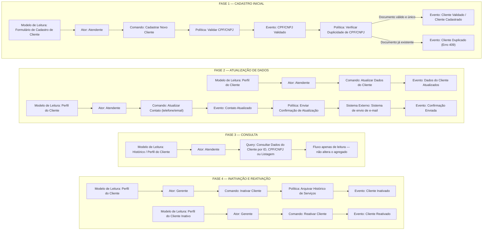

# Event Storming — Agregado: Cliente

> **Ciclo de vida do cliente**: cadastro inicial, atualização de dados e contato, consulta e inativação (Página 6 de [`../event-storming.pdf`](../event-storming.pdf)).

---

## 1. Visão Geral do Agregado

- **Agregado**: `Cliente` ([`Oficina\Customer\Domain\Customer`](../../../src/Customer/Domain/Customer.php))
- **Bounded Context**: Contexto Administrativo — Clientes e Veículos (`src/Customer`)
- **Objetos de Valor Principais**:
  - `Documento` ([`Oficina\Shared\Domain\ValueObject\Document`](../../../src/Shared/Domain/ValueObject/Document.php)) — valida CPF (11 dígitos) e CNPJ (14 caracteres, numérico ou alfanumérico conforme IN RFB nº 2.229/2024) com cálculo dos dígitos verificadores.
  - `Email` ([`Oficina\Shared\Domain\ValueObject\Email`](../../../src/Shared/Domain/ValueObject/Email.php)) — normaliza e valida endereços de e-mail.
  - `Telefone` ([`Oficina\Customer\Domain\Phone`](../../../src/Customer/Domain/Phone.php)) — valida telefones brasileiros com DDD (10 ou 11 dígitos).
  - `CustomerId` ([`Oficina\Customer\Domain\CustomerId`](../../../src/Customer/Domain/CustomerId.php)) — identificador único UUID v4 do agregado.
- **Definição na Linguagem Ubíqua**: *"Pessoa física ou jurídica que contrata os serviços, identificada unicamente e validada pelo seu CPF ou CNPJ."*

---

## 2. Fases do Event Storming (Mapeamento Completo)

---

## 3. Regras de Negócio e Invariantes do Agregado

1. **Validação Obrigatória de CPF/CNPJ**:
   - Todo documento é normalizado (remoção de pontuação e conversão para maiúsculas) e validado matematicamente pelo Objeto de Valor [`Document`](../../../src/Shared/Domain/ValueObject/Document.php), suportando CPF (11 dígitos) e CNPJ (14 caracteres numéricos ou alfanuméricos).
2. **Unicidade de CPF/CNPJ no Sistema**:
   - Não é permitido cadastrar dois clientes com o mesmo CPF ou CNPJ ([`DocumentAlreadyRegisteredException`](../../../src/Customer/Domain/Exception/DocumentAlreadyRegisteredException.php) $\rightarrow$ HTTP `409 Conflict`).
3. **Dados Cadastrais e de Contato**:
   - `nome` (`name`) é obrigatório, higienizado contra espaços duplicados e limitado a `150` caracteres.
   - `email` é obrigatório, normalizado em letras minúsculas e validado pelo Objeto de Valor [`Email`](../../../src/Shared/Domain/ValueObject/Email.php).
   - `telefone` (`phone`) é opcional e, quando informado, deve conter DDD + número válido (10 ou 11 dígitos) validado pelo Objeto de Valor [`Phone`](../../../src/Customer/Domain/Phone.php).
4. **Atualização de Contato e Confirmação por E-mail**:
   - A atualização exclusiva de contato (`updateContact()`) altera `email` e `phone` do cliente ativo e aciona a política de envio de confirmação por e-mail através da porta [`CustomerContactNotifier`](../../../src/Customer/Domain/CustomerContactNotifier.php).
5. **Inativação Segura e Preservação de Histórico**:
   - A inativação (`deactivate()`) realiza exclusão lógica (`active = false`), preservando e arquivando o histórico de Ordens de Serviço e Veículos vinculados ao cliente.
   - Clientes inativos não permitem atualização de dados cadastrais ou de contato sem antes serem reativados (`activate()`).

---

## 4. Rastreabilidade: Documentação DDD $\leftrightarrow$ Implementação no Código

| Fase | Comando / Operação no Event Storming | Caso de Uso (`Application`) | Método no Agregado (`Domain`) | Endpoint REST (`Interfaces`) |
|---|---|---|---|---|
| **Fase 1** | Cadastrar Novo Cliente + Validar CPF/CNPJ + Verificar Duplicidade | [`RegisterCustomer`](../../../src/Customer/Application/RegisterCustomer.php) | `Customer::register(...)` + `Document::from(...)` | `POST /api/customers` |
| **Fase 2** | Atualizar Dados do Cliente | [`UpdateCustomer`](../../../src/Customer/Application/UpdateCustomer.php) | `$customer->revise(...)` | `PUT /api/customers/{customer}` |
| **Fase 2** | Atualizar Contato (telefone/email) + Enviar Confirmação | [`UpdateCustomerContact`](../../../src/Customer/Application/UpdateCustomerContact.php) | `$customer->updateContact(...)` + `CustomerContactNotifier` | `PATCH /api/customers/{customer}/contact` |
| **Fase 3** | Consultar Dados do Cliente por ID | [`FindCustomer`](../../../src/Customer/Application/FindCustomer.php) | `CustomerRepository::findById` | `GET /api/customers/{customer}` |
| **Fase 3** | Consultar Dados do Cliente por CPF/CNPJ | [`FindCustomerByDocument`](../../../src/Customer/Application/FindCustomerByDocument.php) | `CustomerRepository::findByDocument` | `GET /api/customers/document/{document}` |
| **Fase 3** | Listar Clientes (Paginado e com filtro de status) | [`ListCustomers`](../../../src/Customer/Application/ListCustomers.php) | `CustomerRepository::paginate` | `GET /api/customers` |
| **Fase 4** | Inativar Cliente + Arquivar Histórico de Serviços | [`DeactivateCustomer`](../../../src/Customer/Application/DeactivateCustomer.php) | `$customer->deactivate()` | `DELETE /api/customers/{customer}` |
| **Fase 4** | Reativar Cliente | [`ActivateCustomer`](../../../src/Customer/Application/ActivateCustomer.php) | `$customer->activate()` | `PATCH /api/customers/{customer}/activate` |
