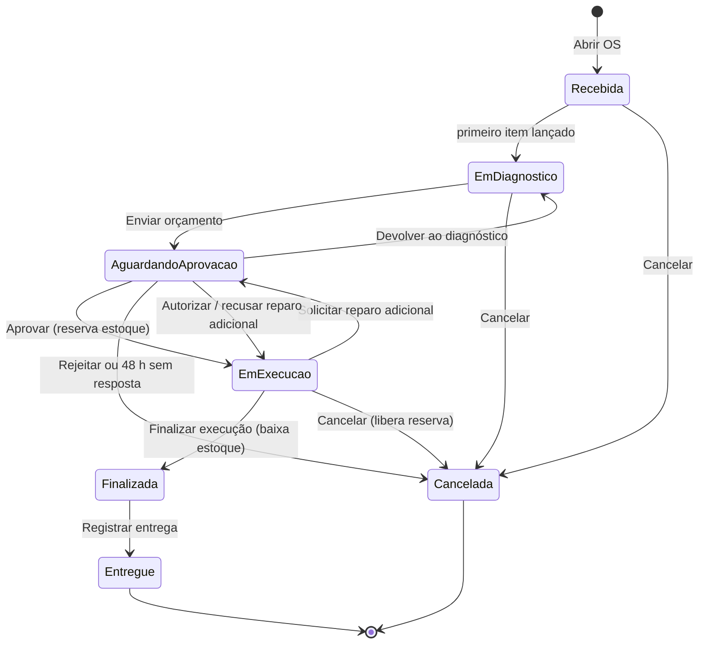

# Event Storming — Agregado: Ordem de Serviço (OS)

> **Ciclo de vida da OS**: abertura, diagnóstico e orçamento, aprovação, execução com reparo adicional e entrega (Página 5 de [`../event-storming.pdf`](../event-storming.pdf)).

---

## 1. Visão Geral do Agregado

- **Agregado**: `Ordem de Serviço` ([`Oficina\ServiceOrder\Domain\ServiceOrder`](../../../src/ServiceOrder/Domain/ServiceOrder.php)) — documento central do atendimento, da abertura à entrega.
- **Entidades internas**:
  - `Item Serviço` ([`ServiceLine`](../../../src/ServiceOrder/Domain/ServiceLine.php)) — cópia congelada de nome, preço e tempo estimado do catálogo.
  - `Item Peça/Insumo` ([`PartLine`](../../../src/ServiceOrder/Domain/PartLine.php)) — cópia congelada de SKU, nome, unidade e preço unitário do estoque.
- **Bounded Context**: Contexto de Atendimento — *Core Domain* (`src/ServiceOrder`).
- **Objetos de Valor**:
  - `Status da OS` ([`ServiceOrderStatus`](../../../src/ServiceOrder/Domain/ServiceOrderStatus.php)) — máquina de estados com 7 status.
  - `Orçamento` ([`Budget`](../../../src/ServiceOrder/Domain/Budget.php)) — soma automática de mão de obra e peças.
  - `Quantidade` ([`Quantity`](../../../src/ServiceOrder/Domain/Quantity.php)) — milésimos, como no Estoque.
  - `Motivo do Cancelamento` ([`CancellationReason`](../../../src/ServiceOrder/Domain/CancellationReason.php)) e `Mudança de Status` ([`StatusChange`](../../../src/ServiceOrder/Domain/StatusChange.php)).
- **Referências externas por id**: cliente, veículo, serviço e peça/insumo.
- **Definição na Linguagem Ubíqua**: *"Documento central que acompanha todo o ciclo de vida do atendimento, registrando o veículo, o cliente, os itens adicionados e o orçamento gerado."*

### Máquina de estados

> **Extensão aos 6 status do enunciado:** *Cancelada* foi decidido pelo grupo no Event Storming. Sem ele, um orçamento rejeitado teria de passar por *Finalizada → Entregue*, o que mistura OS executadas com OS que nunca foram executadas e distorce o tempo médio de execução. Ver [`../linguagem-ubiqua.md`](../linguagem-ubiqua.md).

---

## 2. Fases do Event Storming (Mapeamento Completo)

```mermaid
flowchart TD
    subgraph F1["FASE 1 — ABERTURA DA OS"]
        RM1["Modelo de Leitura: Cadastro de Clientes e Veículos"] --> A1["Ator: Atendente (Administrador)"]
        A1 --> C1["Comando: Identificar Cliente (CPF/CNPJ) e Veículo (placa)"]
        C1 --> P1["Política: Cadastrar Veículo se a placa for nova"]
        P1 --> C2["Comando: Abrir OS"]
        C2 --> EV1["Evento: OS Aberta (Recebida)"]
        EV1 --> P2["Política: Iniciar Diagnóstico"]
    end

    subgraph F2["FASE 2 — DIAGNÓSTICO E ORÇAMENTO"]
        A2["Ator: Mecânico"] --> C3["Comando: Adicionar Serviço"]
        C3 --> P3["Política: Bloquear Serviço Inativo e Sugerir Peças Padrão"]
        P3 --> EV2["Evento: Serviço Adicionado à OS"]
        A2 --> C4["Comando: Adicionar Peça/Insumo"]
        C4 --> P4["Política: Bloquear Peça sem Estoque"]
        P4 --> EV3["Evento: Peça/Insumo Adicionada à OS"]
        A2 --> C5["Comando: Calcular e Enviar Orçamento"]
        C5 --> EV4["Evento: Orçamento Enviado"]
        EV4 --> P5["Política: Notificar Cliente por E-mail (prazo de 48 h)"]
        P5 --> P6["Política: Se 48 h sem resposta, Cancelar OS por Timeout"]
    end

    subgraph F3["FASE 3 — APROVAÇÃO"]
        A3["Ator: Cliente"] --> C6["Comando: Aprovar Orçamento"]
        C6 --> P7["Política: Reservar Estoque (tudo ou nada)"]
        P7 --> EV5["Evento: Orçamento Aprovado (Em Execução, cronômetro iniciado)"]
        A3 --> C7["Comando: Rejeitar Orçamento"]
        C7 --> EV6["Evento: Orçamento Rejeitado"]
        EV6 --> EV7["Evento: OS Cancelada (fila de retirada)"]
    end

    subgraph F4["FASE 4 — EXECUÇÃO E REPARO ADICIONAL"]
        A4["Ator: Mecânico"] --> C8["Comando: Solicitar Reparo Adicional"]
        C8 --> EV8["Evento: Orçamento Enviado (adicional)"]
        EV8 --> A5["Ator: Cliente"]
        A5 --> C9["Comando: Autorizar Reparo Adicional"]
        C9 --> P8["Política: Reservar Peças Extras"]
        P8 --> EV9["Evento: Reparo Adicional Autorizado"]
        A5 --> C10["Comando: Recusar Reparo Adicional"]
        C10 --> EV10["Evento: Reparo Adicional Recusado (mantém escopo)"]
        A4 --> C11["Comando: Finalizar Execução"]
        C11 --> P9["Política: Dar Baixa no Estoque"]
        P9 --> EV11["Evento: Serviços Finalizados (tempo total registrado)"]
        EV11 --> P10["Política: Notificar OS Pronta para Retirada"]
    end

    subgraph F5["FASE 5 — ENTREGA"]
        A6["Ator: Atendente (Administrador)"] --> C12["Comando: Registrar Entrega"]
        C12 --> EV12["Evento: Veículo Entregue (OS Concluída)"]
        RM2["Modelo de Leitura: Acompanhamento da OS"] --> A7["Ator: Cliente"]
        A7 --> C13["Query: Acompanhar OS (número + CPF/CNPJ)"]
    end
```

---

## 3. Regras de Negócio e Invariantes do Agregado

1. **Abertura**:
   - O cliente é identificado pelo CPF/CNPJ e precisa estar ativo. O veículo é identificado pela placa; placa nova é cadastrada já vinculada ao cliente (marca, modelo e ano obrigatórios nesse caso).
   - Veículo de outro cliente ou inativo é recusado (HTTP `422`): a transferência é feita no cadastro de veículos.
2. **Diagnóstico**:
   - O primeiro item lançado move a OS de *Recebida* para *Em diagnóstico* (política *Iniciar Diagnóstico*).
   - Itens só mudam no diagnóstico. Durante a execução, só como reparo adicional.
   - O mesmo serviço não entra duas vezes. A mesma peça incluída de novo soma a quantidade.
   - Peça inativa ou sem saldo **disponível** é recusada na inclusão (`InsufficientStockException` lista o que falta). Isso não reserva: a reserva só acontece na aprovação.
3. **Orçamento**:
   - Calculado automaticamente: soma da mão de obra dos serviços e de `quantidade × preço unitário` das peças, com preços congelados na inclusão.
   - Precisa de ao menos um serviço. O envio abre um prazo de **48 h** e dispara e-mail ao cliente.
4. **Aprovação (tudo ou nada)**:
   - Aprovar reserva as peças na **mesma transação**. Faltando estoque, nada muda e a OS continua *Aguardando aprovação*; o mecânico pode devolver ao diagnóstico e ajustar.
   - A aprovação inicia o cronômetro de execução.
   - Rejeitar cancela a OS (motivo *Orçamento rejeitado pelo cliente*), sem estoque a liberar.
5. **Prazo de 48 h** ([`ExpireOverdueApprovals`](../../../src/ServiceOrder/Application/ExpireOverdueApprovals.php), comando `service-orders:expire-approvals` agendado a cada 15 min):
   - Orçamento inicial vencido cancela a OS (motivo *Orçamento sem resposta no prazo de aprovação*).
   - Reparo adicional vencido é tratado como recusado: a execução continua com o escopo original.
   - Depois do prazo, aprovar ou autorizar é recusado.
6. **Reparo Adicional**:
   - Só em execução. Os novos itens entram pendentes e o cliente recebe um novo pedido de aprovação com o valor extra.
   - Autorizar reserva só as peças extras; recusar remove os itens pendentes. Em ambos os casos a execução continua e o cronômetro não reinicia.
7. **Finalização e Entrega**:
   - Finalizar para o cronômetro, dá baixa automática do que foi reservado e avisa o cliente que o veículo está pronto.
   - Entrega só com a OS *Finalizada*.
8. **Cancelamento**:
   - Possível até a finalização. Se já havia aprovação, a reserva de estoque é liberada.
9. **Histórico e Auditoria**:
   - Toda mudança de status entra no histórico (tabela *append-only*) com data e hora.
10. **Concorrência**:
    - Todo comando bloqueia a OS (`SELECT ... FOR UPDATE`) na transação ([`ServiceOrderCommand`](../../../src/ServiceOrder/Application/ServiceOrderCommand.php)). Isso evita, por exemplo, o cliente aprovar no mesmo instante em que o job de 48 h cancela.
    - E-mails saem só depois do commit (eventos publicados pós-commit); falha de envio só gera log.
11. **Segurança**:
    - O cliente autenticado só vê e decide as próprias OS. OS de outro cliente responde `404`, para não revelar que existe.
    - O acompanhamento público exige número da OS + CPF/CNPJ, tem limite de 20 requisições por minuto por IP e devolve só status, veículo, total, aprovação pendente e histórico.

---

## 4. Rastreabilidade: Documentação DDD $\leftrightarrow$ Implementação no Código

> Endpoints em [`ServiceOrderController`](../../../src/ServiceOrder/Interfaces/Http/ServiceOrderController.php), protegidos por JWT (`auth:api`), e [`TrackServiceOrderController`](../../../src/ServiceOrder/Interfaces/Http/TrackServiceOrderController.php) (público).

| Fase | Comando / Operação no Event Storming | Caso de Uso (`Application`) | Método no Agregado (`Domain`) | Endpoint REST (`Interfaces`) | Perfis |
|---|---|---|---|---|---|
| **Fase 1** | Identificar Cliente e Veículo + Abrir OS | [`OpenServiceOrder`](../../../src/ServiceOrder/Application/OpenServiceOrder.php) | `ServiceOrder::open(...)` | `POST /api/service-orders` | Admin |
| **Fase 2** | Adicionar Serviço + Sugerir Peças Padrão | [`AddServiceToOrder`](../../../src/ServiceOrder/Application/AddServiceToOrder.php) | `$order->addService(...)` | `POST /api/service-orders/{id}/services` | Admin, Mecânico |
| **Fase 2** | Adicionar Peça/Insumo + Bloquear sem Estoque | [`AddPartToOrder`](../../../src/ServiceOrder/Application/AddPartToOrder.php) + [`PartQuoter`](../../../src/ServiceOrder/Application/PartQuoter.php) | `$order->addPart(...)` | `POST /api/service-orders/{id}/parts` | Admin, Mecânico |
| **Fase 2** | Remover Item | [`RemoveOrderItem`](../../../src/ServiceOrder/Application/RemoveOrderItem.php) | `$order->removeService(...)` / `removePart(...)` | `DELETE /api/service-orders/{id}/services/{linha}` e `/parts/{linha}` | Admin, Mecânico |
| **Fase 2** | Calcular e Enviar Orçamento | [`SendBudget`](../../../src/ServiceOrder/Application/SendBudget.php) | `$order->sendBudget(...)` | `POST /api/service-orders/{id}/budget/send` | Admin, Mecânico |
| **Fase 2** | Devolver ao Diagnóstico | [`SendBudget::returnToDiagnosis`](../../../src/ServiceOrder/Application/SendBudget.php) | `$order->returnToDiagnosis(...)` | `POST /api/service-orders/{id}/budget/return-to-diagnosis` | Admin, Mecânico |
| **Fase 2** | Cancelar OS por Timeout (48 h) | [`ExpireOverdueApprovals`](../../../src/ServiceOrder/Application/ExpireOverdueApprovals.php) | `$order->expireApproval(...)` | `php artisan service-orders:expire-approvals` | Agendador |
| **Fase 3** | Aprovar Orçamento + Reservar Estoque | [`DecideBudget::approve`](../../../src/ServiceOrder/Application/DecideBudget.php) | `$order->approveBudget(...)` | `POST /api/service-orders/{id}/budget/approve` | Cliente (dono), Admin |
| **Fase 3** | Rejeitar Orçamento + Cancelar OS | [`DecideBudget::reject`](../../../src/ServiceOrder/Application/DecideBudget.php) | `$order->rejectBudget(...)` | `POST /api/service-orders/{id}/budget/reject` | Cliente (dono), Admin |
| **Fase 4** | Solicitar Reparo Adicional | [`RequestAdditionalRepair`](../../../src/ServiceOrder/Application/RequestAdditionalRepair.php) | `$order->requestAdditionalRepair(...)` | `POST /api/service-orders/{id}/additional-repairs` | Admin, Mecânico |
| **Fase 4** | Autorizar Reparo + Reservar Peças Extras | [`DecideBudget::authorizeAdditional`](../../../src/ServiceOrder/Application/DecideBudget.php) | `$order->authorizeAdditionalRepair(...)` | `POST /api/service-orders/{id}/additional-repairs/authorize` | Cliente (dono), Admin |
| **Fase 4** | Recusar Reparo Adicional | [`DecideBudget::refuseAdditional`](../../../src/ServiceOrder/Application/DecideBudget.php) | `$order->refuseAdditionalRepair(...)` | `POST /api/service-orders/{id}/additional-repairs/refuse` | Cliente (dono), Admin |
| **Fase 4** | Finalizar Execução + Dar Baixa no Estoque | [`ExecuteServiceOrder::finish`](../../../src/ServiceOrder/Application/ExecuteServiceOrder.php) | `$order->finishServices(...)` | `POST /api/service-orders/{id}/finish` | Admin, Mecânico |
| **Fase 5** | Registrar Entrega | [`ExecuteServiceOrder::deliver`](../../../src/ServiceOrder/Application/ExecuteServiceOrder.php) | `$order->deliver(...)` | `POST /api/service-orders/{id}/deliver` | Admin |
| — | Cancelar OS (oficina) + Liberar Reserva | [`ExecuteServiceOrder::cancel`](../../../src/ServiceOrder/Application/ExecuteServiceOrder.php) | `$order->cancel(...)` | `POST /api/service-orders/{id}/cancel` | Admin |
| **Fase 5** | Acompanhar OS (cliente logado) | [`ListServiceOrders`](../../../src/ServiceOrder/Application/ListServiceOrders.php) / [`FindServiceOrder`](../../../src/ServiceOrder/Application/FindServiceOrder.php) | `ServiceOrderRepository::paginate` / `findById` | `GET /api/service-orders` / `GET /api/service-orders/{id}` | Admin, Mecânico, Cliente (só as dele) |
| **Fase 5** | Acompanhar OS (sem login) | [`TrackServiceOrder`](../../../src/ServiceOrder/Application/TrackServiceOrder.php) | — | `GET /api/public/service-orders/{id}?document=...` | Público |
| Monitoramento | Tempo Médio de Execução | [`GetExecutionTimeReport`](../../../src/ServiceOrder/Application/GetExecutionTimeReport.php) | read model SQL | `GET /api/service-orders/metrics/execution-time` | Admin |

### Eventos de Domínio $\leftrightarrow$ Classes

| Evento no Event Storming | Classe (`src/ServiceOrder/Domain/Event`) |
|---|---|
| OS Aberta | `ServiceOrderOpened` |
| Diagnóstico Iniciado | `DiagnosisStarted` |
| Serviço Adicionado à OS | `ServiceAddedToOrder` |
| Peça/Insumo Adicionada à OS | `PartAddedToOrder` |
| Item Removido | `OrderItemRemoved` |
| Orçamento Enviado (inicial ou adicional) | `BudgetSent` |
| Orçamento Devolvido ao Diagnóstico | `BudgetReturnedToDiagnosis` |
| Orçamento Aprovado | `BudgetApproved` |
| Orçamento Rejeitado | `BudgetRejected` |
| Reparo Adicional Autorizado | `AdditionalRepairAuthorized` |
| Reparo Adicional Recusado (pelo cliente ou por prazo) | `AdditionalRepairRefused` |
| Serviços Finalizados | `ServicesFinished` |
| Veículo Entregue | `VehicleDelivered` |
| OS Cancelada | `ServiceOrderCanceled` |

### Políticas $\leftrightarrow$ Implementação

| Política | Onde |
|---|---|
| Iniciar Diagnóstico | `ServiceOrder::guardEditable()` |
| Bloquear Peça sem Estoque | [`PartQuoter`](../../../src/ServiceOrder/Application/PartQuoter.php) via `ServiceOrderStock::checkAvailability` |
| Reservar / Baixar / Liberar Estoque | [`DecideBudget`](../../../src/ServiceOrder/Application/DecideBudget.php) e [`ExecuteServiceOrder`](../../../src/ServiceOrder/Application/ExecuteServiceOrder.php) via contrato do Estoque, na mesma transação |
| Notificar Cliente (orçamento, pronta para retirada, cancelada) | [`CustomerNotificationPolicy`](../../../src/ServiceOrder/Application/CustomerNotificationPolicy.php) + [`LaravelMailServiceOrderNotifier`](../../../src/ServiceOrder/Infrastructure/LaravelMailServiceOrderNotifier.php) |
| Se 48 h sem resposta | [`ExpireOverdueApprovals`](../../../src/ServiceOrder/Application/ExpireOverdueApprovals.php) + agendamento em [`routes/console.php`](../../../routes/console.php) |
