# Event Storming — Agregado: Peça/Insumo

> **Ciclo de vida da peça/insumo**: cadastro, atualização de dados e preço, movimentação de estoque, integração com a Ordem de Serviço, consulta e inativação (Página 9 de [`../event-storming.pdf`](../event-storming.pdf)).

---

## 1. Visão Geral do Agregado

- **Agregado**: `Peça/Insumo` ([`Oficina\Inventory\Domain\InventoryItem`](../../../src/Inventory/Domain/InventoryItem.php)) — um único agregado com `tipo` `PECA` ou `INSUMO`.
- **Agregado auxiliar**: `Reserva de Estoque da OS` ([`Oficina\Inventory\Domain\StockReservation`](../../../src/Inventory/Domain/StockReservation.php)) — uma por OS; guarda o que foi reservado para baixar ou liberar exatamente isso.
- **Entidade interna**: `Movimentação de Estoque` ([`StockMovement`](../../../src/Inventory/Domain/StockMovement.php)) — extrato *append-only* com o saldo físico e reservado após cada lançamento.
- **Bounded Context**: Contexto de Estoque — *Support Domain* (`src/Inventory`).
- **Objetos de Valor**:
  - `Código (SKU)` ([`Sku`](../../../src/Inventory/Domain/Sku.php)) — único, normalizado em maiúsculas.
  - `Quantidade` ([`Quantity`](../../../src/Inventory/Domain/Quantity.php)) — não negativa, até 3 casas decimais (insumo fracionado, ex.: 4,5 L de óleo), guardada em milésimos para cálculo exato.
  - `Unidade de Medida` ([`UnitOfMeasure`](../../../src/Inventory/Domain/UnitOfMeasure.php)) — `UN` (só inteiros), `L`, `KG`, `M`.
  - `Preço de Venda` ([`Money`](../../../src/Shared/Domain/ValueObject/Money.php), Shared Kernel) — em centavos.
- **Definição na Linguagem Ubíqua**: *"Material físico necessário para a execução da OS, que possui quantidade controlada para baixa no estoque."*

**Invariante central:** `disponível = física − reservada` e `disponível ≥ 0` (nunca se reserva mais do que existe).

---

## 2. Fases do Event Storming (Mapeamento Completo)

```mermaid
flowchart TD
    subgraph F1["FASE 1 — CADASTRO DE PEÇA/INSUMO"]
        RM1["Modelo de Leitura: Formulário de Cadastro de Peças/Insumos"] --> A1["Ator: Atendente"]
        A1 --> C1["Comando: Cadastrar Nova Peça/Insumo"]
        C1 --> P1["Política: Verificar Código (SKU) Único"]
        P1 -->|SKU inédito| EV1["Evento: Código Validado / Peça/Insumo Cadastrado"]
        P1 -->|SKU já existente| EV2["Evento: Código Duplicado (Erro 409)"]
        EV1 --> P2["Política: Registrar Estoque Inicial"]
        P2 --> EV3["Evento: Entrada de Estoque Registrada"]
    end

    subgraph F2["FASE 2 — ATUALIZAÇÃO DE DADOS E PREÇO"]
        RM2["Modelo de Leitura: Ficha da Peça/Insumo"] --> A2["Ator: Atendente"]
        A2 --> C2["Comando: Atualizar Dados (nome, fabricante, unidade, mínimo)"]
        C2 --> EV4["Evento: Dados da Peça/Insumo Atualizados"]

        RM3["Modelo de Leitura: Tabela de Preços"] --> A3["Ator: Atendente"]
        A3 --> C3["Comando: Alterar Preço de Venda"]
        C3 --> EV5["Evento: Preço de Venda Alterado"]
        EV5 --> P3["Política: Manter Preço Congelado nos Orçamentos Emitidos"]
    end

    subgraph F3["FASE 3 — MOVIMENTAÇÃO DE ESTOQUE"]
        RM4["Modelo de Leitura: Saldo de Estoque"] --> A4["Ator: Atendente"]
        A4 --> C4["Comando: Registrar Entrada de Estoque"]
        C4 --> EV6["Evento: Entrada de Estoque Registrada"]

        RM5["Modelo de Leitura: Saldo de Estoque"] --> A5["Ator: Atendente"]
        A5 --> C5["Comando: Ajustar Estoque (Inventário)"]
        C5 --> EV7["Evento: Estoque Ajustado"]
        EV7 --> P4["Política: Verificar Estoque Mínimo"]
        P4 --> EV8["Evento: Estoque Mínimo Atingido"]
    end

    subgraph F4["FASE 4 — INTEGRAÇÃO COM A ORDEM DE SERVIÇO"]
        RM6["Modelo de Leitura: Catálogo de Peças (preço e disponível)"] --> A6["Ator: Atendente / Mecânico"]
        A6 --> C6["Query: Consultar Disponibilidade"]
        X1["Sistema Externo — OS: Peça/Insumo Adicionada à OS"] --> P5["Política: Bloquear Peça/Insumo sem Saldo Disponível"]
        P5 --> N1["Fluxo apenas de leitura — não reserva"]

        X2["Sistema Externo — OS: Orçamento Aprovado"] --> P6["Política: Reservar Itens da OS (tudo ou nada)"]
        P6 --> C7["Comando (Sistema): Reservar Estoque"]
        C7 -->|saldo suficiente| EV9["Evento: Estoque Reservado"]
        C7 -->|falta algum item| EV10["Evento: Reserva Recusada por Estoque Insuficiente"]
        EV10 --> P7["Política: Manter OS em Aguardando Aprovação"]

        X3["Sistema Externo — OS: Reparo Adicional Autorizado"] --> P8["Política: Reservar Peças Extras (tudo ou nada)"]
        P8 --> C8["Comando (Sistema): Reservar Itens Extras"]
        C8 --> EV11["Evento: Estoque Reservado"]

        X4["Sistema Externo — OS: OS Cancelada (após aprovação)"] --> P9["Política: Liberar Reservas da OS"]
        P9 --> C9["Comando (Sistema): Liberar Reserva"]
        C9 --> EV12["Evento: Reserva de Estoque Liberada"]

        X5["Sistema Externo — OS: Serviços Finalizados"] --> P10["Política: Baixar Itens Reservados"]
        P10 --> C10["Comando (Sistema): Baixar Estoque"]
        C10 --> EV13["Evento: Estoque Baixado"]
        EV13 --> P11["Política: Verificar Estoque Mínimo"]
        P11 --> EV14["Evento: Estoque Mínimo Atingido"]
    end

    subgraph F5["FASE 5 — CONSULTA E INATIVAÇÃO"]
        RM7["Modelo de Leitura: Extrato de Movimentações"] --> A7["Ator: Administrativo"]
        A7 --> C11["Query: Consultar Extrato da Peça/Insumo"]
        C11 --> N2["Fluxo apenas de leitura — não altera o agregado"]

        RM8["Modelo de Leitura: Lista de Reposição (abaixo do mínimo)"] --> A8["Ator: Atendente"]
        A8 --> C12["Query: Consultar Itens para Reposição"]
        C12 --> N3["Fluxo apenas de leitura"]

        RM9["Modelo de Leitura: Ficha da Peça/Insumo"] --> A9["Ator: Atendente"]
        A9 --> C13["Comando: Inativar Peça/Insumo"]
        C13 --> P12["Política: Verificar Reservas Ativas"]
        P12 -->|sem reserva| EV15["Evento: Peça/Insumo Inativado"]
        EV15 --> P13["Política: Manter Histórico nas OS"]
        P12 -->|com reserva| EV16["Evento: Inativação Bloqueada por Reserva Ativa"]
    end
```

---

## 3. Regras de Negócio e Invariantes do Agregado

1. **Código (SKU) Único e Normalizado**:
   - O SKU é normalizado (espaços removidos, maiúsculas) e validado pelo Objeto de Valor [`Sku`](../../../src/Inventory/Domain/Sku.php): 2 a 40 caracteres entre letras, números, `.`, `-` e `_`.
   - Não é permitido cadastrar duas peças/insumos com o mesmo SKU (`SkuAlreadyRegisteredException` $\rightarrow$ HTTP `409`). O índice único no banco é a última barreira contra cadastros simultâneos.
   - O SKU é imutável após o cadastro.
2. **Quantidades e Unidade de Medida**:
   - Quantidades nunca são negativas e têm no máximo 3 casas decimais.
   - A unidade `UN` aceita apenas quantidades inteiras; `L`, `KG` e `M` aceitam fração.
   - A unidade só pode ser alterada com o estoque zerado (físico e reservado).
3. **Saldo Físico, Reservado e Disponível**:
   - `disponível = física − reservada`; a reservada nunca passa da física. A regra existe no agregado e também como `CHECK` no PostgreSQL.
   - Ajuste de inventário exige motivo e não pode deixar a quantidade física abaixo da reservada.
   - Toda alteração de saldo gera uma `Movimentação de Estoque` (Estoque inicial, Entrada, Ajuste positivo/negativo, Reserva, Liberação de reserva, Baixa).
4. **Preço de Venda Congelado no Orçamento**:
   - O preço é guardado em centavos ([`Money`](../../../src/Shared/Domain/ValueObject/Money.php)). Alterar o preço não muda orçamentos já emitidos: a OS copia o preço no momento do orçamento.
5. **Reserva Tudo ou Nada (decisão do grupo)**:
   - A reserva acontece na **aprovação do orçamento**, na mesma transação da aprovação, e não na inclusão do item na OS (para não prender estoque de orçamentos que o cliente nunca aprova).
   - Se qualquer item não tiver saldo, **nada** é reservado (`InsufficientStockException` lista todos os itens em falta) e a OS continua em *Aguardando aprovação*.
   - Reparo adicional reserva só os itens novos, somando à reserva já existente da OS.
6. **Baixa e Liberação**:
   - A baixa acontece em **Serviços Finalizados** e consome exatamente o que foi reservado.
   - A reserva só é liberada se a OS for **cancelada após a aprovação** (orçamento rejeitado antes da aprovação não chega a reservar).
   - Baixa e liberação são idempotentes: repetir o comando não altera o saldo duas vezes.
7. **Estoque Mínimo**:
   - Quando o disponível fica menor ou igual ao mínimo, o agregado emite *Estoque Mínimo Atingido* (uma vez, na travessia do limite) e o item aparece na Lista de Reposição.
8. **Inativação Segura**:
   - A inativação é lógica (`active = false`), preservando o histórico das OS que usaram o item.
   - É bloqueada enquanto houver estoque reservado; item inativo não recebe entrada nem reserva.
9. **Transações e Concorrência**:
   - Toda alteração de saldo bloqueia a linha do item (`SELECT ... FOR UPDATE`), sempre em ordem de id para evitar *deadlock* entre duas OS que reservam os mesmos itens (ADR 0001).

---

## 4. Rastreabilidade: Documentação DDD $\leftrightarrow$ Implementação no Código

> Endpoints em [`InventoryItemController`](../../../src/Inventory/Interfaces/Http/InventoryItemController.php), todos protegidos por JWT (`auth:api`). Perfis: **mecânico** e **administrador** consultam catálogo, ficha e reposição; somente o **administrador** cadastra, altera, movimenta o estoque, vê o extrato, inativa e reativa. Cliente recebe 403.

| Fase | Comando / Operação no Event Storming | Caso de Uso (`Application`) | Método no Agregado (`Domain`) | Endpoint REST (`Interfaces`) |
|---|---|---|---|---|
| **Fase 1** | Cadastrar Nova Peça/Insumo + Verificar SKU Único + Registrar Estoque Inicial | [`RegisterInventoryItem`](../../../src/Inventory/Application/RegisterInventoryItem.php) | `InventoryItem::register(...)` + `Sku::from(...)` | `POST /api/parts` |
| **Fase 2** | Atualizar Dados (nome, fabricante, unidade, mínimo) | [`UpdateInventoryItem`](../../../src/Inventory/Application/UpdateInventoryItem.php) | `$item->revise(...)` | `PUT /api/parts/{id}` |
| **Fase 2** | Alterar Preço de Venda | [`ChangeInventoryItemPrice`](../../../src/Inventory/Application/ChangeInventoryItemPrice.php) | `$item->changePrice(...)` | `PATCH /api/parts/{id}/price` |
| **Fase 3** | Registrar Entrada de Estoque | [`ReceiveStock`](../../../src/Inventory/Application/ReceiveStock.php) | `$item->receive(...)` | `POST /api/parts/{id}/receipts` |
| **Fase 3** | Ajustar Estoque (Inventário) | [`AdjustStock`](../../../src/Inventory/Application/AdjustStock.php) | `$item->adjust(...)` | `POST /api/parts/{id}/adjustments` |
| **Fase 4** | Consultar Disponibilidade | [`ServiceOrderStock::checkAvailability`](../../../src/Inventory/Application/Contract/ServiceOrderStock.php) | `$item->canReserve(...)` | — (chamado pela OS) |
| **Fase 4** | Reservar Estoque / Reservar Itens Extras | [`ServiceOrderStock::reserve`](../../../src/Inventory/Application/Contract/ServiceOrderStock.php) | `$item->reserve(...)` + `$reservation->add(...)` | — (chamado pela OS) |
| **Fase 4** | Liberar Reserva | [`ServiceOrderStock::release`](../../../src/Inventory/Application/Contract/ServiceOrderStock.php) | `$item->releaseReservation(...)` + `$reservation->release()` | — (chamado pela OS) |
| **Fase 4** | Baixar Estoque | [`ServiceOrderStock::consume`](../../../src/Inventory/Application/Contract/ServiceOrderStock.php) | `$item->consume(...)` + `$reservation->consume()` | — (chamado pela OS) |
| **Fase 5** | Consultar Extrato da Peça/Insumo | [`ListStockMovements`](../../../src/Inventory/Application/ListStockMovements.php) | `InventoryItemRepository::movementsOf` | `GET /api/parts/{id}/movements` |
| **Fase 5** | Consultar Itens para Reposição | [`ListItemsBelowMinimum`](../../../src/Inventory/Application/ListItemsBelowMinimum.php) | `InventoryItemRepository::belowMinimum` | `GET /api/parts/restock` |
| **Fase 5** | Consultar Catálogo / Ficha | [`ListInventoryItems`](../../../src/Inventory/Application/ListInventoryItems.php) / [`FindInventoryItem`](../../../src/Inventory/Application/FindInventoryItem.php) | `InventoryItemRepository::paginate` / `findById` | `GET /api/parts` / `GET /api/parts/{id}` |
| **Fase 5** | Inativar Peça/Insumo + Verificar Reservas Ativas | [`DeactivateInventoryItem`](../../../src/Inventory/Application/DeactivateInventoryItem.php) | `$item->deactivate()` | `DELETE /api/parts/{id}` |
| **Fase 5** | Reativar Peça/Insumo | [`ReactivateInventoryItem`](../../../src/Inventory/Application/ReactivateInventoryItem.php) | `$item->reactivate()` | `PATCH /api/parts/{id}/activate` |

### Eventos de Domínio $\leftrightarrow$ Classes

| Evento no Event Storming | Classe (`src/Inventory/Domain/Event`) |
|---|---|
| Peça/Insumo Cadastrado | `InventoryItemRegistered` |
| Dados da Peça/Insumo Atualizados | `InventoryItemUpdated` |
| Preço de Venda Alterado | `InventoryItemPriceChanged` |
| Entrada de Estoque Registrada | `StockReceived` (estoque inicial: movimentação `ESTOQUE_INICIAL`) |
| Estoque Ajustado | `StockAdjusted` |
| Estoque Mínimo Atingido | `MinimumStockReached` |
| Estoque Reservado | `StockReserved` |
| Reserva Recusada por Estoque Insuficiente | `StockReservationRefused` |
| Reserva de Estoque Liberada | `StockReservationReleased` |
| Estoque Baixado | `StockConsumed` |
| Peça/Insumo Inativado | `InventoryItemDeactivated` |
| Peça/Insumo Reativado | `InventoryItemReactivated` |
| Código Duplicado / Inativação Bloqueada por Reserva Ativa | Exceções de domínio: `SkuAlreadyRegisteredException` (409) e `DomainException` (422) |
