# Event Storming — Agregado: Serviço

> **Ciclo de vida do serviço do catálogo**: cadastro, atualização de dados, preço e tempo, peças padrão, integração com a Ordem de Serviço, consulta e inativação (Página 14 de [`../event-storming.pdf`](../event-storming.pdf)).

---

## 1. Visão Geral do Agregado

- **Agregado**: `Serviço` ([`Oficina\Catalog\Domain\Service`](../../../src/Catalog/Domain/Service.php)) — procedimento oferecido pela oficina (ex.: troca de óleo, alinhamento).
- **Entidade interna**: `Peça Padrão` ([`StandardPart`](../../../src/Catalog/Domain/StandardPart.php)) — peça/insumo usada normalmente no serviço, referenciada só pelo id do Estoque, com a quantidade sugerida.
- **Bounded Context**: Contexto Administrativo — Catálogo (`src/Catalog`).
- **Objetos de Valor**:
  - `Código do Serviço` ([`ServiceCode`](../../../src/Catalog/Domain/ServiceCode.php)) — único, maiúsculo e imutável (ex.: `TROCA-OLEO`).
  - `Preço da Mão de Obra` ([`Money`](../../../src/Shared/Domain/ValueObject/Money.php), Shared Kernel) — em centavos.
  - `Tempo Estimado` — minutos, de 1 a 43.200 (30 dias).
- **Definição na Linguagem Ubíqua**: *"Procedimento técnico/mecânico (ex.: troca de óleo, alinhamento) solicitado para inclusão na OS."*

**Invariante central:** serviço inativo não entra em orçamento novo, mas continua nas OS antigas (exclusão lógica).

---

## 2. Fases do Event Storming (Mapeamento Completo)

```mermaid
flowchart TD
    subgraph F1["FASE 1 — CADASTRO DE SERVIÇO"]
        RM1["Modelo de Leitura: Formulário de Cadastro de Serviço"] --> A1["Ator: Administrador"]
        A1 --> C1["Comando: Cadastrar Serviço"]
        C1 --> P1["Política: Verificar Código e Nome Únicos"]
        P1 -->|inéditos| EV1["Evento: Serviço Cadastrado"]
        P1 -->|repetido| EV2["Evento: Serviço Duplicado (Erro 409)"]
        EV1 --> P2["Política: Disponibilizar no Catálogo de Orçamento"]
    end

    subgraph F2["FASE 2 — ATUALIZAÇÃO DE DADOS, PREÇO E TEMPO"]
        RM2["Modelo de Leitura: Ficha do Serviço"] --> A2["Ator: Administrador"]
        A2 --> C2["Comando: Atualizar Dados (nome, descrição, categoria)"]
        C2 --> EV3["Evento: Dados do Serviço Atualizados"]

        A2 --> C3["Comando: Alterar Preço da Mão de Obra"]
        C3 --> EV4["Evento: Preço da Mão de Obra Alterado"]
        EV4 --> P3["Política: Manter Preço Congelado nos Orçamentos Emitidos"]

        A2 --> C4["Comando: Ajustar Tempo Estimado"]
        C4 --> EV5["Evento: Tempo Estimado Ajustado"]
    end

    subgraph F3["FASE 3 — PEÇAS PADRÃO"]
        RM3["Modelo de Leitura: Catálogo de Peças (Estoque)"] --> A3["Ator: Administrador"]
        A3 --> C5["Comando: Vincular Peça Padrão"]
        C5 --> P4["Política: Exigir Peça Ativa no Estoque"]
        P4 --> EV6["Evento: Peça Padrão Vinculada"]
        A3 --> C6["Comando: Desvincular Peça Padrão"]
        C6 --> EV7["Evento: Peça Padrão Desvinculada"]
        X1["Sistema Externo — Estoque: Peça/Insumo Inativado"] --> P5["Política: Remover das Peças Padrão"]
        P5 --> EV7
    end

    subgraph F4["FASE 4 — INTEGRAÇÃO COM A ORDEM DE SERVIÇO"]
        X2["Sistema Externo — OS: Adicionar Serviço"] --> P6["Política: Bloquear Serviço Inativo"]
        P6 --> P7["Política: Sugerir Peças Padrão na OS"]
        X3["Sistema Externo — OS: Serviços Finalizados"] --> P8["Política: Recalcular Tempo Médio de Execução"]
        X4["Sistema Externo — OS: OS Cancelada"] --> P9["Política: Ignorar no Tempo Médio"]
    end

    subgraph F5["FASE 5 — CONSULTA E INATIVAÇÃO"]
        RM4["Modelo de Leitura: Catálogo de Serviços"] --> A4["Ator: Administrador / Mecânico / Cliente"]
        A4 --> C7["Query: Consultar Catálogo"]
        RM5["Modelo de Leitura: Tempo Médio de Execução"] --> A5["Ator: Administrador"]
        A5 --> C8["Query: Consultar Tempo Médio de Execução"]
        RM6["Modelo de Leitura: Ficha do Serviço"] --> A6["Ator: Administrador"]
        A6 --> C9["Comando: Inativar Serviço"]
        C9 --> EV8["Evento: Serviço Inativado"]
        EV8 --> P10["Política: Ocultar dos Novos Orçamentos e Manter Histórico nas OS"]
        A6 --> C10["Comando: Reativar Serviço"]
        C10 --> EV9["Evento: Serviço Reativado"]
    end
```

---

## 3. Regras de Negócio e Invariantes do Agregado

1. **Código e Nome Únicos**:
   - O código é normalizado (espaços removidos, maiúsculas) e validado por [`ServiceCode`](../../../src/Catalog/Domain/ServiceCode.php): 2 a 30 caracteres entre letras, números, `.`, `-` e `_`. É imutável.
   - Nome único sem diferenciar maiúsculas (índice `lower(name)` no banco). Repetição gera `ServiceAlreadyRegisteredException` (HTTP `409`).
2. **Preço Congelado no Orçamento**:
   - A OS copia nome, preço e tempo estimado no momento em que o serviço entra no orçamento. Alterar o catálogo depois não muda OS já orçadas.
3. **Tempo Estimado**:
   - Inteiro em minutos entre 1 e 43.200. É a referência comparada com o tempo real no monitoramento.
4. **Peças Padrão**:
   - Cada peça aparece uma vez; vincular de novo atualiza a quantidade (até 3 casas decimais).
   - Só peça **ativa** no Estoque pode ser padrão. Quando o Estoque inativa a peça, ela sai de todos os serviços ([`RemoveDeactivatedPartFromServices`](../../../src/Catalog/Application/RemoveDeactivatedPartFromServices.php), disparado pelo evento `InventoryItemDeactivated` após o commit).
   - As peças padrão são **sugestão**: ao incluir o serviço, a OS devolve a lista, e o mecânico decide o que lançar (a disponibilidade é conferida na inclusão da peça).
5. **Inativação Lógica**:
   - `active = false`: some da listagem padrão (`include_inactive=1` mostra) e é recusado em orçamento novo (`InactiveServiceException`, HTTP `422`). As OS antigas mantêm a cópia do serviço.
6. **Tempo Médio de Execução (read model)**:
   - Calculado sob demanda no contexto da OS ([`GetExecutionTimeReport`](../../../src/ServiceOrder/Application/GetExecutionTimeReport.php)), do início da execução (aprovação) até *Serviços Finalizados*. OS canceladas ficam fora.
   - Por serviço, é a média das OS finalizadas que contêm o serviço, comparada ao tempo estimado congelado (a OS não cronometra cada serviço separadamente).
7. **Concorrência**:
   - Comandos bloqueiam o serviço (`SELECT ... FOR UPDATE`) dentro da transação ([`LockedServiceCommand`](../../../src/Catalog/Application/LockedServiceCommand.php)).

---

## 4. Rastreabilidade: Documentação DDD $\leftrightarrow$ Implementação no Código

> Endpoints em [`ServiceController`](../../../src/Catalog/Interfaces/Http/ServiceController.php), todos protegidos por JWT (`auth:api`). Perfis: **administrador**, **mecânico** e **cliente** consultam o catálogo; somente o **administrador** cadastra e altera.

| Fase | Comando / Operação no Event Storming | Caso de Uso (`Application`) | Método no Agregado (`Domain`) | Endpoint REST (`Interfaces`) |
|---|---|---|---|---|
| **Fase 1** | Cadastrar Serviço + Verificar Código e Nome Únicos | [`RegisterService`](../../../src/Catalog/Application/RegisterService.php) | `Service::register(...)` + `ServiceCode::from(...)` | `POST /api/services` |
| **Fase 2** | Atualizar Dados (nome, descrição, categoria) | [`UpdateService`](../../../src/Catalog/Application/UpdateService.php) | `$service->revise(...)` | `PUT /api/services/{id}` |
| **Fase 2** | Alterar Preço da Mão de Obra | [`ChangeServicePrice`](../../../src/Catalog/Application/ChangeServicePrice.php) | `$service->changePrice(...)` | `PATCH /api/services/{id}/price` |
| **Fase 2** | Ajustar Tempo Estimado | [`AdjustServiceEstimatedTime`](../../../src/Catalog/Application/AdjustServiceEstimatedTime.php) | `$service->adjustEstimatedTime(...)` | `PATCH /api/services/{id}/estimated-time` |
| **Fase 3** | Vincular Peça Padrão + Exigir Peça Ativa | [`LinkStandardPart`](../../../src/Catalog/Application/LinkStandardPart.php) | `$service->linkStandardPart(...)` | `PUT /api/services/{id}/standard-parts` |
| **Fase 3** | Desvincular Peça Padrão | [`UnlinkStandardPart`](../../../src/Catalog/Application/UnlinkStandardPart.php) | `$service->unlinkStandardPart(...)` | `DELETE /api/services/{id}/standard-parts/{partId}` |
| **Fase 3** | Remover das Peças Padrão (peça inativada) | [`RemoveDeactivatedPartFromServices`](../../../src/Catalog/Application/RemoveDeactivatedPartFromServices.php) | `$service->unlinkStandardPart(...)` | — (evento do Estoque) |
| **Fase 4** | Bloquear Serviço Inativo + Sugerir Peças Padrão | [`ServiceCatalog::quote`](../../../src/Catalog/Application/Contract/ServiceCatalog.php) | `$service->guardAvailableForBudget()` | — (chamado pela OS) |
| **Fase 5** | Consultar Catálogo / Ficha | [`ListServices`](../../../src/Catalog/Application/ListServices.php) / [`FindService`](../../../src/Catalog/Application/FindService.php) | `ServiceRepository::paginate` / `findById` | `GET /api/services` / `GET /api/services/{id}` |
| **Fase 5** | Consultar Tempo Médio de Execução | [`GetExecutionTimeReport`](../../../src/ServiceOrder/Application/GetExecutionTimeReport.php) | read model SQL | `GET /api/service-orders/metrics/execution-time` |
| **Fase 5** | Inativar Serviço | [`DeactivateService`](../../../src/Catalog/Application/DeactivateService.php) | `$service->deactivate()` | `DELETE /api/services/{id}` |
| **Fase 5** | Reativar Serviço | [`ReactivateService`](../../../src/Catalog/Application/ReactivateService.php) | `$service->reactivate()` | `PATCH /api/services/{id}/activate` |

### Eventos de Domínio $\leftrightarrow$ Classes

| Evento no Event Storming | Classe (`src/Catalog/Domain/Event`) |
|---|---|
| Serviço Cadastrado | `ServiceRegistered` |
| Dados do Serviço Atualizados | `ServiceUpdated` |
| Preço da Mão de Obra Alterado | `ServicePriceChanged` |
| Tempo Estimado Ajustado | `ServiceEstimatedTimeAdjusted` |
| Peça Padrão Vinculada | `StandardPartLinked` |
| Peça Padrão Desvinculada | `StandardPartUnlinked` |
| Serviço Inativado | `ServiceDeactivated` |
| Serviço Reativado | `ServiceReactivated` |
| Serviço Duplicado / Serviço Inativo | Exceções de domínio: `ServiceAlreadyRegisteredException` (409) e `InactiveServiceException` (422) |
