# Event Storming — Agregado: Veículo

> **Ciclo de vida do veículo**: cadastro, atualização, consulta, transferência e inativação (Página 7 de [`../event-storming.pdf`](../event-storming.pdf)).

---

## 1. Visão Geral do Agregado

- **Agregado**: `Veículo` ([`Oficina\Customer\Domain\Entity\Vehicle`](../../../src/Customer/Domain/Entity/Vehicle.php))
- **Bounded Context**: Contexto Administrativo — Clientes e Veículos (`src/Customer`)
- **Objeto de Valor Principal**: `Placa` ([`Oficina\Shared\Domain\ValueObject\LicensePlate`](../../../src/Shared/Domain/ValueObject/LicensePlate.php)) — valida placas brasileiras no padrão antigo (`ABC1234`) e Mercosul (`ABC1D23`).
- **Definição na Linguagem Ubíqua**: *"O automóvel do cliente que passará pela manutenção, identificado unicamente por sua placa, marca, modelo e ano."*

---

## 2. Fases do Event Storming (Mapeamento Completo)

```mermaid
flowchart TD
    subgraph F1["FASE 1 — CADASTRO DE VEÍCULO"]
        RM1["Modelo de Leitura: Formulário de Cadastro de Veículo"] --> A1["Ator: Atendente"]
        A1 --> C1["Comando: Cadastrar Novo Veículo"]
        C1 --> P1["Política: Verificar Placa no Sistema (Formato e Unicidade)"]
        P1 -->|Placa válida e única| EV1["Evento: Placa Validada / Veículo Cadastrado"]
        P1 -->|Placa já existente| EV2["Evento: Placa Duplicada (Erro 422)"]
        EV1 --> P2["Política: Associar ao Cliente"]
        P2 --> EV3["Evento: Veículo Associado ao Cliente"]
    end

    subgraph F2["FASE 2 — ATUALIZAÇÃO DE DADOS"]
        RM2["Modelo de Leitura: Ficha do Veículo"] --> A2["Ator: Atendente"]
        A2 --> C2["Comando: Atualizar Dados do Veículo (marca, modelo, ano, cor)"]
        C2 --> EV4["Evento: Dados do Veículo Atualizados"]

        RM3["Modelo de Leitura: Histórico de Quilometragem"] --> A3["Ator: Mecânico / Atendente"]
        A3 --> C3["Comando: Registrar Quilometragem Atual"]
        C3 --> EV5["Evento: Quilometragem Registrada"]
    end

    subgraph F3["FASE 3 — CONSULTA"]
        RM4["Modelo de Leitura: Histórico / Ficha do Veículo"] --> A4["Ator: Atendente / Cliente"]
        A4 --> C4["Query: Consultar Veículo por ID, Placa ou Cliente"]
        C4 --> N1["Fluxo apenas de leitura — não altera o agregado"]
    end

    subgraph F4["FASE 4 — TRANSFERÊNCIA, INATIVAÇÃO E REATIVAÇÃO"]
        RM5["Modelo de Leitura: Ficha do Veículo"] --> A5["Ator: Atendente"]
        A5 --> C5["Comando: Transferir Veículo para Outro Cliente"]
        C5 --> P4["Política: Desvincular do cliente anterior e vincular ao novo"]
        P4 --> EV6["Evento: Proprietário Alterado / Veículo Transferido"]

        RM6["Modelo de Leitura: Ficha do Veículo"] --> A6["Ator: Atendente"]
        A6 --> C6["Comando: Inativar Veículo"]
        C6 --> P5["Política: Preservar histórico de manutenções"]
        P5 --> EV7["Evento: Veículo Inativado"]

        RM7["Modelo de Leitura: Ficha do Veículo Inativo"] --> A7["Ator: Atendente"]
        A7 --> C7["Comando: Reativar Veículo"]
        C7 --> EV8["Evento: Veículo Reativado"]
    end
```

---

## 3. Regras de Negócio e Invariantes do Agregado

1. **Validação Obrigatória de Placa**:
   - Toda placa é normalizada (remoção de espaços/hífens e conversão para maiúsculas) e validada pelo Objeto de Valor [`LicensePlate`](../../../src/Shared/Domain/ValueObject/LicensePlate.php) nos padrões `^[A-Z]{3}\d{4}$` (antigo) ou `^[A-Z]{3}\d[A-Z]\d{2}$` (Mercosul).
2. **Unicidade de Placa no Sistema**:
   - Não é permitido cadastrar dois veículos com a mesma placa (`VehicleAlreadyExistsException` $\rightarrow$ HTTP `422`).
3. **Dados Obrigatórios (Edital Fase 1)**:
   - `placa` (`license_plate`), `marca` (`brand`), `modelo` (`model`) e `ano` (`year`) são obrigatórios.
   - O `ano` deve ser um ano automotivo válido (entre `1900` e `ano_atual + 1`).
4. **Evolução Consistente de Quilometragem**:
   - A quilometragem (`mileage`) não pode ser negativa (`>= 0`) e, ao registrar uma nova quilometragem em manutenção, o valor informado não pode ser inferior à quilometragem já registrada no veículo.
5. **Inativação Segura e Operações em Veículo Inativo**:
   - A inativação (`deactivate()`) realiza exclusão lógica (`active = false`), preservando a integridade referencial e o histórico de Ordens de Serviço do veículo.
   - Veículos inativos não permitem registro de nova quilometragem ou transferência de propriedade sem antes serem reativados (`activate()`).

---

## 4. Rastreabilidade: Documentação DDD $\leftrightarrow$ Implementação no Código

| Fase | Comando / Operação no Event Storming | Caso de Uso (`Application`) | Método no Agregado (`Domain`) | Endpoint REST (`Interfaces`) |
|---|---|---|---|---|
| **Fase 1** | Cadastrar Novo Veículo + Verificar Placa + Associar ao Cliente | [`CreateVehicleUseCase`](../../../src/Customer/Application/UseCase/CreateVehicleUseCase.php) | `Vehicle::create(...)` + `LicensePlate::from(...)` | `POST /api/vehicles` |
| **Fase 2** | Atualizar Dados do Veículo | [`UpdateVehicleUseCase`](../../../src/Customer/Application/UseCase/UpdateVehicleUseCase.php) | `$vehicle->update(...)` | `PUT /api/vehicles/{id}` |
| **Fase 2** | Registrar Quilometragem Atual | [`RegisterVehicleMileageUseCase`](../../../src/Customer/Application/UseCase/RegisterVehicleMileageUseCase.php) | `$vehicle->registerMileage(...)` | `PATCH /api/vehicles/{id}/mileage` |
| **Fase 3** | Consultar Veículo por ID | [`GetVehicleByIdUseCase`](../../../src/Customer/Application/UseCase/GetVehicleByIdUseCase.php) | `VehicleRepositoryInterface::findById` | `GET /api/vehicles/{id}` |
| **Fase 3** | Consultar Veículo por Placa | [`GetVehicleByLicensePlateUseCase`](../../../src/Customer/Application/UseCase/GetVehicleByLicensePlateUseCase.php) | `VehicleRepositoryInterface::findByLicensePlate` | `GET /api/vehicles/plate/{plate}` |
| **Fase 3** | Listar Veículos (Geral ou por Cliente) | [`ListVehiclesUseCase`](../../../src/Customer/Application/UseCase/ListVehiclesUseCase.php) | `VehicleRepositoryInterface::findAll` / `findByCustomerId` | `GET /api/vehicles` |
| **Fase 4** | Transferir Veículo para Outro Cliente | [`TransferVehicleOwnershipUseCase`](../../../src/Customer/Application/UseCase/TransferVehicleOwnershipUseCase.php) | `$vehicle->transferOwnership(...)` | `PATCH /api/vehicles/{id}/transfer` |
| **Fase 4** | Inativar Veículo | [`DeactivateVehicleUseCase`](../../../src/Customer/Application/UseCase/DeactivateVehicleUseCase.php) | `$vehicle->deactivate()` | `DELETE /api/vehicles/{id}` |
| **Fase 4** | Reativar Veículo | [`ActivateVehicleUseCase`](../../../src/Customer/Application/UseCase/ActivateVehicleUseCase.php) | `$vehicle->activate()` | `PATCH /api/vehicles/{id}/activate` |
